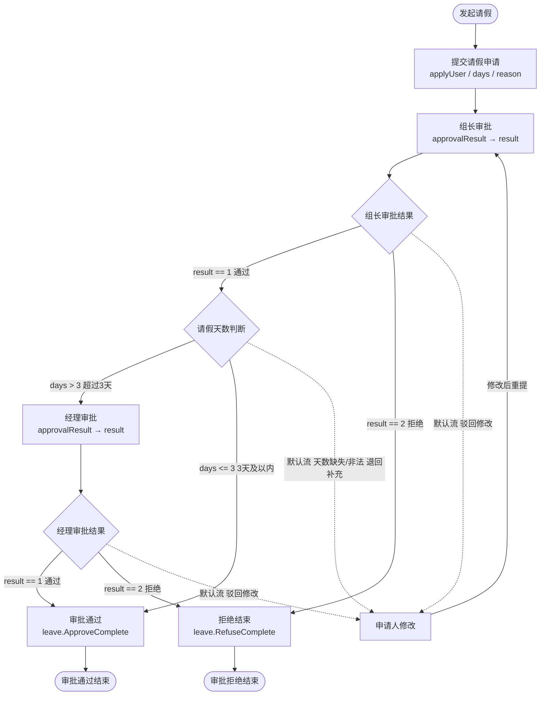

# NetBpm 流程设计指引

> **配套示例**：请假审批流程 —— [`web/designer/examples/leave-process.bpmn20.xml`](../web/designer/examples/leave-process.bpmn20.xml)；
> 订单审批流程 —— [`web/designer/examples/order-process.bpmn20.xml`](../web/designer/examples/order-process.bpmn20.xml)  
> **可运行 Demo**：[`samples/NetBpm.Demo`](../samples/NetBpm.Demo)（一个宿主承载两条流程；JSON / MySQL 双模式，`dotnet run` 即用；详见其 [README](../samples/NetBpm.Demo/README.md)）  
> **设计器**：`http://localhost:5273/?modelId=<模型 id>`  
> **适用范围**：NetBpm 流程子集（BPMN 2.0 子集 + Activiti 解析行为 + Activiti 运行时语义）

本指引回答三件事：

1. **每个环节（节点）怎么设** —— 用哪些属性、属性什么含义；
2. **每条线（顺序流）怎么设** —— 条件写在哪儿、什么时候该留空；
3. **表达式怎么写** —— `${...}` 里能写什么、写出来引擎怎么算、哪些写法会踩坑。

第 5、6 节列出**部署期会被直接拒掉的写法**和**宿主必须自己补的三件事**；第 7 节说明这些机械活已经被封装成开箱即用的应用层 —— 这几处最容易在"图能画出来、跑起来不对"时被忽略。

---

## 目录

- [1. 流程全景与数据模型](#1-流程全景与数据模型)
- [2. 各环节怎么设](#2-各环节怎么设)
- [3. 顺序流（连线）怎么设](#3-顺序流连线怎么设)
- [4. 表达式怎么写](#4-表达式怎么写)
- [5. 部署期校验红线](#5-部署期校验红线)
- [6. 宿主必须自己补的三件事](#6-宿主必须自己补的三件事)
- [7. 流程应用层封装（NetBpm.Workflow）](#7-流程应用层封装netbpmworkflow)
- [8. 流程升级与实例迁移](#8-流程升级与实例迁移)
- [9. 改流程后的自查清单](#9-改流程后的自查清单)
- [10. 附录](#10-附录)

---

## 1. 流程全景与数据模型

### 1.1 流转图



虚线是**默认流**（`default`），它不带条件、只做兜底。

### 1.2 节点清单（12 个）

| #  | id                      | 类型                 | 名称     | 关键设置                                                          |
| -- | ----------------------- | ------------------ | ------ | ------------------------------------------------------------- |
| 1  | `start`                 | `startEvent`       | 发起请假   | 唯一开始事件                                                        |
| 2  | `task_apply`            | `userTask`         | 提交请假申请 | `assignee="${applyUser}"`；表单 `days`(long,必填) / `reason`(string) |
| 3  | `task_leader_approve`   | `userTask`         | 组长审批   | `candidateGroups="leaders"`；表单 `approvalResult`(enum,必填)      |
| 4  | `gw_leader`             | `exclusiveGateway` | 组长审批结果 | `default="flow_leader_modify"`                                |
| 5  | `task_apply_modify`     | `userTask`         | 申请人修改  | `assignee="${applyUser}"`；表单与 `task_apply` 相同                 |
| 6  | `gw_days`               | `exclusiveGateway` | 请假天数判断 | `default="flow_days_modify"`（兜底退回补充）                        |
| 7  | `task_manager_approve`  | `userTask`         | 经理审批   | `candidateGroups="managers"`；表单 `approvalResult`(enum,必填)     |
| 8  | `gw_manager`            | `exclusiveGateway` | 经理审批结果 | `default="flow_manager_modify"`                               |
| 9  | `task_approve_complete` | `serviceTask`      | 审批通过   | `delegateExpression="leave.ApproveComplete"`                  |
| 10 | `task_refuse`           | `serviceTask`      | 拒绝结束   | `delegateExpression="leave.RefuseComplete"`                   |
| 11 | `end_approved`          | `endEvent`         | 审批通过结束 | —                                                             |
| 12 | `end_refused`           | `endEvent`         | 审批拒绝结束 | —                                                             |

### 1.3 连线清单（16 条）

| #  | id                    | 从 → 到                                       | 名称    | 条件表达式            |
| -- | --------------------- | ------------------------------------------- | ----- | ---------------- |
| 1  | `flow_start_apply`    | `start` → `task_apply`                      | —     | 无                |
| 2  | `flow_apply_leader`   | `task_apply` → `task_leader_approve`        | —     | 无                |
| 3  | `flow_leader_gw`      | `task_leader_approve` → `gw_leader`         | —     | 无                |
| 4  | `flow_leader_pass`    | `gw_leader` → `gw_days`                     | 通过    | `${result == 1}` |
| 5  | `flow_leader_refuse`  | `gw_leader` → `task_refuse`                 | 拒绝    | `${result == 2}` |
| 6  | `flow_leader_modify`  | `gw_leader` → `task_apply_modify`           | 驳回修改  | 无（**默认流**）       |
| 7  | `flow_modify_leader`  | `task_apply_modify` → `task_leader_approve` | 修改后重提 | 无                |
| 8  | `flow_days_over3`     | `gw_days` → `task_manager_approve`          | 超过3天  | `${days &gt; 3}` |
| 9  | `flow_days_within3`   | `gw_days` → `task_approve_complete`         | 3天及以内 | `${days &lt;= 3}` |
| 10 | `flow_days_modify`    | `gw_days` → `task_apply_modify`             | 退回补充  | 无（**默认流**）       |
| 11 | `flow_manager_gw`     | `task_manager_approve` → `gw_manager`       | —     | 无                |
| 12 | `flow_manager_pass`   | `gw_manager` → `task_approve_complete`      | 通过    | `${result == 1}` |
| 13 | `flow_manager_refuse` | `gw_manager` → `task_refuse`                | 拒绝    | `${result == 2}` |
| 14 | `flow_manager_modify` | `gw_manager` → `task_apply_modify`          | 驳回修改  | 无（**默认流**）       |
| 15 | `flow_approve_end`    | `task_approve_complete` → `end_approved`    | —     | 无                |
| 16 | `flow_refuse_end`     | `task_refuse` → `end_refused`               | —     | 无                |

> XML 里 `>` 必须写成 `&gt;`，否则不是合法 XML。

### 1.4 四条业务路径

| 路径            | 走法                                          | 终态                                       |
| ------------- | ------------------------------------------- | ---------------------------------------- |
| **A. 短假直接通过** | 组长 `result=1` → `days <= 3`                   | `leave.ApproveComplete` → `end_approved` |
| **B. 长假经理通过** | 组长 `result=1` → `days > 3` → 经理 `result=1`  | `leave.ApproveComplete` → `end_approved` |
| **C. 拒绝**     | 组长**或**经理 `result=2`                        | `leave.RefuseComplete` → `end_refused`   |
| **D. 驳回修改**   | 组长**或**经理 `result=3`（落到默认流）→ 申请人改完重提 → 回到组长 | 转入 A/B/C 之一                              |
| **E. 天数缺失/非法** | `days` 没写或不是数字 → `gw_days` 落默认流「退回补充」→ 申请人补填 | 转入 A/B/C 之一（**不会静默通过**）             |

### 1.5 BaseModel（业务基础模型）

流程实例上挂的业务元数据，固定 7 个字段、**扁平写成流程变量**（变量名 = 字段名，条件里可直接写 `${result == 1}`）：

| 字段 | 含义 | 谁写 | 什么时候 |
| --------------- | ---------------- | -------- | ------------------------ |
| `businessId` | 业务 Id | 宿主 | 发起（`request.BusinessKey`） |
| `businessDeptId` | 业务部门 | 宿主 | 发起 |
| `applyUser` | 申请人 | 宿主 | 发起（`request.Applicant`） |
| `applyTime` | 申请时间 | 宿主 | 发起（引擎时间） |
| `applyDeptId` | 申请部门 | 宿主 | 发起 |
| `result` | 审批结果 | 审批人表单 | 审批时（`variable="result"`） |
| `comment` | 审批说明 | 审批人表单 | 审批时 |

> ⚠️ 任务指派要用 `${applyUser}`，不要用宿主内部起的名字 —— **变量名是流程契约的一部分**，
> 换个宿主或前端就得跟着改。`src/NetBpm.Workflow` 的 `BaseModel` 与 BPMN 里这 7 个名字是一份约定。

### 1.6 approvalResult（审批选项）

组长 / 经理审批任务上的表单属性，候选值定义在 BPMN 里（`activiti:formProperty` 的 `activiti:value`）：

| 选项 id | 名称 | 绑定变量 |
| ----- | -------- | --------------------- |
| `1` | 通过 | `result`（`variable="result"`） |
| `2` | 拒绝 | `result` |
| `3` | 驳回修改 | `result` |

三条纪律：

1. **选项的唯一来源是 BPMN**。前端不写死 1/2/3 —— 后端把候选值随待办一起下发，前端照着画。
2. **`enum` 的 `id` 必须是数字**。条件里写的是 `result == 1`；选项 id 改成 `"pass"` 这类文本，比较时会抛异常。
3. **改选项要两边同步**：BPMN 的 `activiti:value` 与代码里的 `ApprovalResult` 枚举数值必须一致，
   应用层用 `ApprovalResultFormGuard` 在部署期自检，不一致**直接拒绝启动**。

> 显示名（通过 / 拒绝 / 驳回修改）同样来自 BPMN，以 `resultName` / `decisionName` 随视图下发 —— 改文案不用改前端。

### 1.7 ParaDict（流程参数表）

`days`、`reason` 这类**业务参数**走 `ParaDict`，与 `BaseModel` 分开管：

| | BaseModel | ParaDict |
| -------- | --------------------------- | ---------------------------------- |
| 形状 | 固定 7 个字段 | 任意键值对 |
| 语义 | 流程元数据（谁、哪个部门、什么结论） | 业务参数（几天、什么理由） |
| 存法 | 流程变量 | **流程参数表**（实例 × 参数名），同时展开成流程变量 |

三个来源、两个去处：

```text
发起请求的 paraDict ──┐
表单字段（按 variable）─┼─→ 流程参数表（按 key 覆盖）─┬─→ 业务查询（流程结束后仍可查）
审批时的显式 paraDict ─┘                          └─→ 流程变量（供条件表达式用）
```

- 更新语义是**按 key 覆盖**：只动传进来的键，没提到的保持原样；
- ⚠️ 参数名**不能与 `BaseModel` 的 7 个字段重名**（发起与审批两个方向都会拦），否则返回 400；
- ⚠️ 参数表**不是** `ACT_RU_VARIABLE`：后者是引擎运行期变量、流程一结束就清空，参数表是业务侧留痕。

---

## 2. 各环节怎么设

> **一个 BPMN 文件只能有一个 `isExecutable="true"` 的流程。** 多个会被部署/校验拒绝
> （`<process>` 不写 `isExecutable` 时按可执行处理）。非可执行流程（协作图 / 文档流程）
> 不参与部署；要在一个文件里放多条流程，只能保留一条可执行。

### 2.1 开始事件 `startEvent`

```xml
<bpmn:startEvent id="start" name="发起请假">
  <bpmn:outgoing>flow_start_apply</bpmn:outgoing>
</bpmn:startEvent>
```

- 一个流程**恰好一个**开始事件（多个会被 `start-and-end-event` 拒绝）。
- 只有一条出流，无条件。
- 用 `startEvent` 而不是 `intermediateCatchEvent`；后者依赖定时/消息/信号，本子集未实现。

### 2.2 用户任务 `userTask`

用户任务是人参与环节，有三组属性要设：**基本属性 / 办理人 / 表单**。

#### 2.2.1 基本属性

| 属性                 | 必需 | 说明                                        |
| ------------------ | -- | ----------------------------------------- |
| `id`               | ✅  | 全局唯一；服务任务的 `delegateExpression`、表单映射都靠它定位 |
| `name`             | —  | 图上显示、待办列表里显示的名字                           |
| `activiti:formKey` | —  | 表单标识，**引擎只透传不执行**，由宿主自己解释                 |

```xml
<bpmn:userTask id="task_leader_approve" name="组长审批" activiti:formKey="leave-approve">
```

#### 2.2.2 办理人（三选一，可组合）

| 属性                         | 语义                    | 示例                                    |
| -------------------------- | --------------------- | ------------------------------------- |
| `activiti:assignee`        | **直接指派**给某人，任务建出来就是他的 | `activiti:assignee="${applyUser}"`    |
| `activiti:candidateUsers`  | **候选人**，需认领           | `activiti:candidateUsers="alice,bob"` |
| `activiti:candidateGroups` | **候选组**，组内所有人都能认领     | `activiti:candidateGroups="leaders"`  |

三个属性**都按表达式求值**，所以：

- 想指派给"发起人"→ `assignee="${applyUser}"`（应用层在发起时把申请人写成变量 `applyUser`，见 1.5）。  
  引擎另有一个内置隐式对象 `initiator`（= 流程实例的发起用户），写 `assignee="${initiator}"` 也可以，不依赖宿主传变量。
- 值是**字面量**时不必加 `${}`：`candidateGroups="leaders"` 是合法的"文本表达式"，求值出来还是 `leaders`。
- 多个候选**用逗号分隔**：`candidateGroups="leaders,managers"`，引擎会按 `,`（允许前后空格）切成多个值。
- ⚠️ 求值结果**必须是字符串**，否则抛 `Expression did not resolve to a string or collection of strings`。

> 三点都要注意：
>
> - **无人办理是合法的**：三个都不写，任务照常创建，只是没人认领。要查这类任务得按流程实例查（`TaskQuery.processInstanceId`），不能按办理人查。
> - `assignee` 与 `candidateGroups` 同时写时，**按办理人（`assignee`）查询优先**，不会把候选任务也捞出来 —— 传阅/兜底任务展示时别踩这个坑。
> - 按候选组查待办需要**正确装配 `IUserGroupManager`**。默认实现什么组都没有，会永远查不到候选组任务（Demo 因此替换成了 `DemoUserGroupManager`）。

#### 2.2.3 表单：`activiti:formProperty`

这是"**审批选项由流程定义驱动**"的关键 —— 选项写在 BPMN 里，页面照着渲染，改选项不用改代码。

```xml
<bpmn:userTask id="task_leader_approve" name="组长审批" activiti:candidateGroups="leaders" activiti:formKey="leave-approve">
  <bpmn:extensionElements>
    <activiti:formProperty id="approvalResult" name="审批结果" type="enum" required="true" variable="result">
      <activiti:value id="1" name="通过" />
      <activiti:value id="2" name="拒绝" />
      <activiti:value id="3" name="驳回修改" />
    </activiti:formProperty>
  </bpmn:extensionElements>
  <bpmn:incoming>flow_apply_leader</bpmn:incoming>
  <bpmn:incoming>flow_modify_leader</bpmn:incoming>
  <bpmn:outgoing>flow_leader_gw</bpmn:outgoing>
</bpmn:userTask>
```

#### 2.2.4 `formProperty` 属性全表

| 属性                      | 必需      | 说明                                                 |
| ----------------------- | ------- | -------------------------------------------------- |
| `id`                    | ✅       | 表单字段名。**宿主提交时的键就用它**                               |
| `name`                  | —       | 界面显示标签                                             |
| `type`                  | —       | `string`（默认）/ `long` / `date` / `boolean` / `enum` |
| `required`              | —       | 是否为必填；宿主负责校验                                       |
| `variable`              | —       | **绑定到哪个流程变量**。不写则变量名 = `id`                        |
| `default`               | —       | 默认值                                                |
| `datePattern`           | —       | `type="date"` 时的格式，如 `yyyy-MM-dd`                  |
| `readable` / `writable` | —       | 读写权限，宿主自取                                          |
| `activiti:value`（子元素）   | enum 必需 | 枚举选项：`id` 是**真正落进变量的值**，`name` 是显示文本               |

#### 2.2.5 变量落点规则（很重要）

```
目标变量名 = variable 非空 ? variable : id
```

本流程里两处典型用法：

| 表单字段                   | `variable` | 落成的流程变量                          | 用处                   |
| ---------------------- | ---------- | -------------------------------- | -------------------- |
| `approvalResult`（enum） | `result`   | `result` = `"1"` / `"2"` / `"3"` | 网关条件 `result == 1` 等 |
| `days`（long）           | `days`     | `days` = 整数                      | 网关条件 `days > 3`      |
| `reason`（string）       | `reason`   | `reason` = 文本                    | 业务数据留痕               |


**enum 落成的是"选项 id 的字符串"**（`"1"`、`"2"`、`"3"`），不是数字 —— 这是 Activiti 的既有行为。好在 EL 比较时 `"2" == 2` 会被转成长整数比较，结果为 `true`（详见 [4.4](#44-比较语义三条必须记住的规则)），所以图上写 `result == 2` 就能正常工作。

> 想让 `days` 也生效，就别把它糊成 string。`type="long"` 让宿主把它转成整数再写进变量。

#### 2.2.6 ⚠️ 引擎对 `formProperty` 只透传不执行

引擎会把 `formProperty` 原样挂到流程模型的 `UserTask.FormProperties` 上，**但不会**：

- 不会自动把表单值写进流程变量；
- 不会校验 `required`；
- 不会执行 `expression`。

也就是说，"**表单值 → 流程变量**"这一步必须有人补。这项工作已经封装在应用层 `WorkflowFormMapper.MapToVariables`（见第 7 节）：

```csharp
// 目标变量名取 variable，未写则用 id；类型按 type 转换
var target = string.IsNullOrWhiteSpace(property.Variable) ? property.Id : property.Variable;
```

替换选择与类型转换、必填校验、非法枚举拦截都在那里做。**这是应用层 / 宿主的职责，不是流程图的职责** —— 图上只管把契约写清楚。

### 2.3 排他网关 `exclusiveGateway`

排他网关（异或）是"按条件二选一"的地方。本流程有三处。

```xml
<bpmn:exclusiveGateway id="gw_leader" name="组长审批结果" default="flow_leader_modify">
  <bpmn:incoming>flow_leader_gw</bpmn:incoming>
  <bpmn:outgoing>flow_leader_pass</bpmn:outgoing>
  <bpmn:outgoing>flow_leader_refuse</bpmn:outgoing>
  <bpmn:outgoing>flow_leader_modify</bpmn:outgoing>
</bpmn:exclusiveGateway>
```

设置要点：

1. **默认流与无条件出流至少有一个。**  
   若每条出流都带条件且没设默认流，条件全假时选不出流，运行期会抛  
   `No outgoing sequence flow of the exclusive gateway 'xxx' could be selected` ——  
   校验规则 `exclusive-gateway-has-selectable-flow` 会在**部署期**就拦下来。  
   本指引的示例统一用「默认流」做兜底，但**留一条无条件出流同样合法**，两种写法按团队习惯统一即可。
2. **默认流必须指向本网关的出流，且不要写条件。**  
   写错 id / 指向别的节点的流会被 `default-flow` 规则**拒绝部署**；  
   按 Activiti 语义，默认流只做兜底，它上面的条件不参与判定（写的条件不会被用来挑选它），规则会给提示。
3. **判定顺序 = `<bpmn:outgoing>` 的书写顺序。**  
   引擎取**第一条"条件为真且不是默认流"**&#x7684;出流，选中即停。  
   多个条件同时为真时**不会报错**，谁在前谁赢 —— 互斥条件之间没有顺序问题，但有重叠时顺序就是优先级。
4. 无条件出流恒为真（`ConditionUtil`：空条件直接返回 `true`）。

> ⚠️ **默认流会"吃掉"变量缺失**：`result` 没写进来时，`result == 1`、`result == 2` 都是 `false`，于是静默落到默认流"驳回修改"。  
> 流程不会报错，但走向很可能是错的。**必填校验要在宿主侧做**（Demo 靠 `required="true"` + `MapToVariables` 拦住）。  
> 也正因如此，**默认流的兜底方向必须是保守的**（退回修改 / 转人工 / 报错），绝不能默认"通过" ——
> 示例里 `gw_days` 的默认流就是「退回补充」，而不是"3 天及以内通过"。

### 2.4 服务任务 `serviceTask`

服务任务是自动化环节，用来处理业务数据。**必须指定实现方式**，三种选一：

| 属性                            | 含义                        |
| ----------------------------- | ------------------------- |
| `activiti:delegateExpression` | 表达式求值出的**对象**作为委托（本流程用这个） |
| `activiti:class`              | 类型名                       |
| `activiti:expression`         | 表达式直接求值调用                 |

```xml
<bpmn:serviceTask id="task_approve_complete" name="审批通过" activiti:delegateExpression="leave.ApproveComplete">
  <bpmn:incoming>flow_days_within3</bpmn:incoming>
  <bpmn:incoming>flow_manager_pass</bpmn:incoming>
  <bpmn:outgoing>flow_approve_end</bpmn:outgoing>
</bpmn:serviceTask>
```

委托约定：

```csharp
public interface IServiceTaskDelegate
{
    ValueTask ExecuteAsync(IDelegateExecution execution, CancellationToken ct = default);
}
```

写业务数据的三个入口（都在 `IDelegateExecution` 上）：

| 用途        | 代码                                                                          |
| --------- | --------------------------------------------------------------------------- |
| 读流程变量     | `await execution.GetVariableAsync("days", ct)`                              |
| 写/改流程变量   | `await execution.SetVariableAsync("x", value, ct)`                          |
| 当前节点 / 实例 | `execution.CurrentFlowElement as ServiceTask`、`execution.ProcessInstanceId` |

Demo 的 `leave.ApproveComplete` / `leave.RefuseComplete` 就是两个委托，各只剩一句话
（落盘那套 —— 读变量、还原 `BaseModel`、取参数快照、写结论 —— 都收进了应用层的 `CompleteAsync`）。

**`delegateExpression` 取值怎么被解析成对象？** 顺序是：

1. 按名字取 keyed 服务：`GetKeyedService<object>("leave.ApproveComplete")`；
2. 回退到已注册的 `IServiceTaskDelegate`，用**类型全名或短名**匹配。

`leave.ApproveComplete` 不是任何类型的名字，所以要让它能被解析。**不要逐个手写 keyed 注册**，
名字写在类上、由程序集扫描登记即可：

```csharp
[ServiceTaskName("leave.ApproveComplete")]
public sealed class ApproveCompleteDelegate : IServiceTaskDelegate
{
    public ValueTask ExecuteAsync(IDelegateExecution execution, CancellationToken ct = default) =>
        _workflow.CompleteAsync(execution, WorkflowOutcomes.Approved, ct);
}

// 组合根只需一行（见 NetBpm.Runtime/ServiceTaskDelegateRegistrationExtensions.cs）
builder.Services.AddServiceTaskDelegates(typeof(Program).Assembly);
```

> 类型全名 / 短名也会被登记成别名，所以 `delegateExpression` 直接写类名同样能解析。
> 部署期 `ServiceTaskDelegateGuard` 会把「名字写错 / 忘了注册」在启动时拦下来，而不是等流程跑到那儿。

> 同一个委托被两条线汇入是允许的（`task_approve_complete` 有两条入流），引擎不会执行两次 —— 每次只有一条路径能走到它。

### 2.5 结束事件 `endEvent`

```xml
<bpmn:endEvent id="end_approved" name="审批通过结束">
  <bpmn:incoming>flow_approve_end</bpmn:incoming>
</bpmn:endEvent>
```

- 至少一个结束事件；可以有多个（本流程按"通过/拒绝"分了两个，语义更清楚，也方便画图）。
- 结束事件**不需要出流**（`node-has-outgoing-flow` 对它放行）。
- 要"终止整个流程实例"（打断并行分支、取消会签剩余实例）请用**终止结束事件**，
  见 §2.9；本流程各分支互斥，不需要它。

### 2.6 手写 XML 时的两条纪律

设计器会自动维护下面两项，**手写 XML 时最容易漏**：

1. **`incoming` / `outgoing` 必须与 `sequenceFlow` 的 `sourceRef` / `targetRef` 双向一致。**  
   节点上写了 `<bpmn:incoming>X</bpmn:incoming>`，就得有一条 `id="X"` 的 flow 以它为 `targetRef`；反之亦然。  
   网关的判定顺序**就是 `outgoing` 的书写顺序**，所以顺序也不能随便抄。
2. **`BPMNDiagram`（图形信息）要补齐**：每个节点一个 `BPMNShape`、每条线一个 `BPMNEdge`，坐标别重叠。  
   少了图形信息，图打开就是空白/错位。用设计器画完再导出最省事。

### 2.7 多实例用户任务（会签 / 串签）

同一环节需要多个审批人时，不要画 N 个用户任务，给一个用户任务加
`multiInstanceLoopCharacteristics`：

```xml
<bpmn:userTask id="task_sign" name="会签" activiti:assignee="${approver}">
  <bpmn:multiInstanceLoopCharacteristics isSequential="false"
                                        activiti:collection="${approvers}"
                                        activiti:elementVariable="approver">
    <bpmn:completionCondition>${nrOfCompletedInstances == 3}</bpmn:completionCondition>
  </bpmn:multiInstanceLoopCharacteristics>
</bpmn:userTask>
```

| 配置 | 含义 | 约束 |
|---|---|---|
| `activiti:collection` | 集合表达式，元素个数 = 实例数 | 与 `loopCardinality` **二选一** |
| `<loopCardinality>` | 实例数（数字或表达式） | 同上 |
| `activiti:elementVariable` | 把集合元素逐实例写入该变量 | 用集合时建议必填，否则实例之间无法区分 |
| `isSequential` | `false` 并行会签（同时建 N 个任务）/ `true` 串签 | 缺省并行 |
| `<completionCondition>` | 每完成一个实例判定一次，为真即收口并取消剩余实例 | 如 `${nrOfCompletedInstances == 3}` |

- 循环变量（落在流程实例作用域，与 Activiti 同名）：`nrOfInstances` / `nrOfActiveInstances` /
  `nrOfCompletedInstances` / `loopCounter`（1 起）。
- **只支持用户任务**：服务 / 脚本 / 手工任务配多实例会被 `multi-instance` 规则拒绝。
- **多实例任务不支持 `skipExpression`**（与实例计数冲突，部署期拒绝）。
- 设计器属性面板「多实例（会签 / 串签）」组可直接配置以上全部字段。
- **历史活动行（`ACT_HI_ACTINST`）每实例一行**（对齐 Activiti）：串签在同一执行上依次开合；
  会签每个实例一行（另加主执行的容器行），实例完成即收口、提前完成时剩余行记录取消原因 ——
  审计能精确到「谁在哪一票」。并行模式下 `loopCounter` / `elementVariable` 变量只反映最后创建的实例
  （仍为已登记偏差，任务的办理人在创建时逐实例求值，不受影响）。

### 2.8 定时边界事件（超时自动流转）

「审批 48 小时未处理 → 自动转办 / 退回 / 提醒」用**边界定时事件**，不要把等待写成服务任务轮询：

```xml
<bpmn:userTask id="task_manager_approve" name="经理审批" activiti:assignee="${manager}" />

<bpmn:boundaryEvent id="timer_manager" attachedToRef="task_manager_approve" cancelActivity="true">
  <bpmn:timerEventDefinition>
    <bpmn:timeDuration>PT48H</bpmn:timeDuration>
  </bpmn:timerEventDefinition>
</bpmn:boundaryEvent>

<bpmn:sequenceFlow id="flow_timeout" sourceRef="timer_manager" targetRef="task_escalate" />
```

- **只支持中断型、一次性、挂在用户任务上**；`cancelActivity="false"`、`timeCycle`、
  挂服务/脚本任务都会被 `boundary-event-configuration` 拒绝。
- `timeDuration` 与 `timeDate` 二选一，可写表达式（任务创建时求值，例如 `${timeout}`）。
- 到点后：删除待办（删除原因 `boundary timer`）、收口该任务的历史活动行、沿边界事件出流继续。
- 作业落 `ACT_RU_TIMER_JOB`，由宿主后台服务轮询（默认 5 秒）；任务先完成则作业自动作废。
- **边界分支与原任务分支是互斥的**：边界出流与原任务的出流汇合时，必须用**排他/包含网关**，
  不能直接连并行网关的 join（原分支不会再产生 token，join 会一直等）。
- **会签/串签节点不支持边界定时器**（实例级超时与会签计数会脱节），请把超时放到会签外层。
- 设计器的调色板提供「边界定时器」：先选中用户任务，再点击它。

> **兜底方向要保守**：超时默认「转人工 / 退回补充」，不要默认「自动通过」——
> 定时器只是兜底，不能替代审批人的判断。

### 2.9 终止结束事件（立即终止整个实例）

普通结束事件只结束**当前分支**；并行网关的其它分支仍会继续。需要「一票否决 / 立即终止」时用：

```xml
<bpmn:endEvent id="end_terminate">
  <bpmn:terminateEventDefinition />
</bpmn:endEvent>
```

- 到达即终止整个流程实例：删除执行树、取消全部待办（含并行分支、会签剩余实例）、收口历史。
- **不能有出流**（`terminate-end-event` 规则拒绝）。
- 历史：`ACT_HI_PROCINST.DELETE_REASON_ = terminate end event`，`END_ACT_ID_` 指向该结束事件；
  不触发 `PROCESS_COMPLETED`。
- 设计器：选中结束事件 → 勾选「终止结束事件」。

---

## 3. 顺序流（连线）怎么设

### 3.1 两种形态

```xml

<bpmn:sequenceFlow id="flow_modify_leader" sourceRef="task_apply_modify" targetRef="task_leader_approve" name="修改后重提" />


<bpmn:sequenceFlow id="flow_days_over3" sourceRef="gw_days" targetRef="task_manager_approve" name="超过3天">
  <bpmn:conditionExpression xsi:type="bpmn:tFormalExpression">${days &gt; 3}</bpmn:conditionExpression>
</bpmn:sequenceFlow>
```

要点：

| 项                         | 规则                                             |
| ------------------------- | ---------------------------------------------- |
| `id`                      | 全局唯一，网关的 `default` 要引用它                        |
| `sourceRef` / `targetRef` | 必须能解析到节点，否则 `sequence-flow-reference` 报错       |
| `name`                    | 显示在线上（"通过"、"拒绝"），建议写，图上是重要的信息                  |
| `conditionExpression`     | 写在**子元素**里，`xsi:type="bpmn:tFormalExpression"` |
| `>` `<`                   | XML 里必须转义成 `&gt;` `&lt;`                       |

### 3.2 什么时候"不写条件"

三种情况都**不该**写条件：

1. **默认流**：条件不参与判定。
2. **网关之外的单出流**（如 `task_apply → task_leader_approve`）：只有一条路，条件写了也是多余。
3. **汇合后的流**（如 `task_approve_complete → end_approved`）：没有分支语义。

### 3.3 条件为真怎么判定

`ConditionUtil.HasTrueConditionAsync` 的规则很硬：

```
无 conditionExpression            → true
有 conditionExpression            → 求值结果 === true（严格布尔）
```

⚠️ 所以条件表达式**必须返回布尔**。写 `${days}` 或 `${result}` 这种"返回数字/字符串"的写法不算真 —— 只有 `true` 才算。

---

## 4. 表达式怎么写

### 4.1 语法总览

```
${ 表达式 }       立即求值（BPMN 条件/属性统一用这个）
#{ 表达式 }       延迟求值（本子集与 ${} 等价，但两者不能混用）
```

- **整串先 `trim()` 再解析**（照搬 JUEL）：`"${ a } "` 里的空格会被去掉。
- 不含 `${}` 的纯文本是合法的"字面量表达式"，求值出来就是它自己 —— 所以 `candidateGroups="leaders"` 能用。
- 一个字符串里可以有多段：`${a}-${b}` 会拼成 `a-b`。
- **部署期会预解析全部表达式**（`expression-parseable`）：语法错误在部署时就拒绝，
  不用等流程跑到该节点。检查范围含条件、办理人、`dueDate`、`priority`、`skipExpression`、
  多实例的实例数/集合/完成条件、监听器表达式。变量是否存在仍由运行期决定。

### 4.2 变量从哪来

表达式里能直接用的名字：

| 来源         | 例子                                 | 说明                                    |
| ---------- | ---------------------------------- | ------------------------------------- |
| **流程变量**   | `days`、`reason`、`result`、`applyUser` | 发起时传入 + 表单映射写入 + 委托写入                 |
| **内置隐式对象** | `initiator`                        | 流程实例的发起用户（`StartUserId`），未认证时为 `null` |
| 执行实体属性     | `execution`、`task` 等按需暴露           | 取决于上下文                                |

变量查找沿**作用域向上**（当前执行 → 父执行 → … → 流程实例根）。  
在流程实例根上写一次，所有分支都能看见 —— 这也是"**提交任务时把结果写进流程实例变量**"的常规做法（否则兄弟分支互相看不到）。

Demo 里变量是这样进去的：

| 时机    | 变量                           | 写法                                                                                                     |
| ----- | ---------------------------- | ------------------------------------------------------------------------------------------------------ |
| 发起流程  | BaseModel 七字段 + ParaDict      | 应用层合并成扁平字典后交 `StartProcessInstanceAsync(definitionId, businessKey, applicant, variables, ct)`（见 7.1） |
| 提交任务  | `days` / `reason` / `result` | `formProperty` 的 `variable` 决定名字，`WorkflowFormMapper` 转换类型                                            |
| 服务任务内 | 任意                           | `execution.SetVariableAsync(name, value, ct)`                                                          |

> ⚠️ **同名变量二次写入在内存宿主下曾经会被丢弃**（`VariableInstance.Value` 是唯一真身）。  
> 该缺陷已修复并加了回归测试 `tests/NetBpm.UnitTests/VariableScopeTests.cs`。  
> 如果你在别的分支上遇到"值改不动"，先确认是否基于旧版本。

### 4.3 运算符与优先级

从低到高（严格照搬 JUEL）：

| 优先级 | 运算符                                   | 备注                    |
| --- | ------------------------------------- | --------------------- |
| 1   | `? :`                                 | 三元，右结合：`${a ? b : c}` |
| 2   | `\|\|`、`or`                           | 逻辑或                   |
| 3   | `&&`、`and`                            | 逻辑与                   |
| 4   | `==`、`eq`、`!=`、`ne`                   | 相等                    |
| 5   | `<`、`<=`、`>`、`>=`、`lt`、`le`、`gt`、`ge` | 比较                    |
| 6   | `+`、`-`                               | 加减                    |
| 7   | `*`、`/`、`div`、`%`、`mod`               | 乘除模                   |
| 8   | `-`、`!`、`not`、`empty`                 | 一元                    |
| 9   | `.`、`[]`、`()`                         | 属性 / 索引 / 方法          |

两个容易误用的点：

- **`+` 永远是算术，从不拼字符串。**  
  `${"a" + "b"}` 不是 `"ab"`，会走数字转换并报错。拼字符串要用多段：`${a}${b}`。
- **`/` 恒为浮点除法。**  
  `${7 / 2}` 是 `3.5` 不是 `3`；取整要用 `%` 或三元判断。

### 4.4 比较语义（三条必须记住的规则）

这三条**不是实现细节，是会直接决定走错分支的行为**：

| 写法                                 | 结果                  | 说明                        |
| ---------------------------------- | ------------------- | ------------------------- |
| `null == 1`、`null > 1`、`null <= 1` | **全部 `false`**（不报错） | 变量缺失时比较恒假                 |
| `"2" == 2`                         | **`true`**          | 命中整数分支，字符串按 `Long` 解析后比   |
| `"abc" == 1`                       | **抛异常**             | 同样命中整数分支，但 `"abc"` 解析不成整数 |
| `"1.0" == 1`                       | **抛异常**             | 同上，`"1.0"` 不是合法长整数        |
| `"a" == "a"`                       | `true`              | 两边都是字符串时按序数比较             |

**数值提升顺序**（比较时）：`decimal` → `float/double` → `BigInteger` → `整型(long)` → `字符串` → `IComparable` → 抛异常。

对本流程的意义：

- `result` 落成字符串 `"2"`，`${result == 2}` 走整数分支 → `2 == 2` → `true` ✅
- `days` 是 `long`，`${days > 3}` 走整数分支 ✅
- 如果哪天有人把 `result` 写成 `"通过"` 这种文本，`${result == 1}` 会**抛异常**而不是返回 false —— 别改 enum 选项 id 的含义。

### 4.5 本流程的表达式逐条解释

| 表达式              | 出现位置                                       | 怎么算                                        |
| ---------------- | ------------------------------------------ | ------------------------------------------ |
| `${applyUser}`   | `task_apply.assignee`                      | 取变量 `applyUser`（申请人）→ 任务直接指派给他              |
| `${result == 1}` | `flow_leader_pass`、`flow_manager_pass`     | `result`（字符串 `"1"`）→ 长整数 `1`，`1 == 1` → 通过 |
| `${result == 2}` | `flow_leader_refuse`、`flow_manager_refuse` | 同上，`2 == 2` → 拒绝                           |
| `${days > 3}`    | `flow_days_over3`                          | `days`（long）与 `3` 比较，`4 > 3` → 走经理审批       |
| `${days <= 3}`   | `flow_days_within3`                        | `days` 存在且 ≤ 3 → 直接审批通过                     |
| （无）              | 三条默认流                                      | 空条件恒真，但只能在前面都没命中时兜底（方向都是退回修改）              |


### 4.6 常见写法对照

| 需求    | 写法                                   |
| ----- | ------------------------------------ |
| 等于某值  | `${status == 'approved'}`            |
| 不等于   | `${status != 'draft'}`               |
| 数值区间  | `${days > 3 && days <= 10}`          |
| 二者其一  | `${type == 'A' \|\| type == 'B'}`    |
| 字符串为空 | `${empty reason}`                    |
| 非空    | `${!empty reason}`                   |
| 三元取值  | `${days > 3 ? 'manager' : 'leader'}` |
| 取属性   | `${order.amount > 1000}`             |
| 取下标   | `${items[0] == 'x'}`                 |

> ⚠️ **不支持 EL 函数**（`${fn:length(x)}`、`${myFunc(x)}`）：解析期就会响亮失败，不会静默当变量处理。需要函数逻辑请挪到服务任务委托或宿主侧。

---

## 5. 部署期校验红线

流程在**部署时**会跑一遍校验（`NetBpm.Bpmn.Validation`），不通过直接抛 `ProcessValidationException`，消息里带**元素 id**。提前知道这些能省很多调试时间：

| 规则名 | 级别 | 触发条件 | 怎么改 |
|---|---|---|---|
| `process-id` | 错误 / 提示 | 流程 id 为空（错误）；不符合标识符习惯，如含冒号（提示） | 补 id；建议字母/下划线开头 |
| `node-has-outgoing-flow` | 错误 | 非结束事件没有出流 | 补一条出流，或改成结束事件 |
| `no-orphan-node` | 提示 | 非开始/边界事件没有入流 | 补一条入流 |
| `unique-element-id` | 错误 | id 重复或为空 | 改 id |
| `exclusive-gateway-has-selectable-flow` | 错误 | 排他网关每条出流都带条件且没有默认流 | **加 `default`，或留一条无条件出流** |
| `inclusive-gateway` | 错误 | 包含网关缺入/出流，或全条件且无默认流 | 同上 |
| `parallel-gateway-flow-count` | 错误 / 提示 | 并行网关缺入/出流（错误）；设了默认流（提示，不生效） | 并行网关**不支持**默认流 |
| `event-gateway-unsupported` | 错误 | 用了事件网关 | 换排他/包含网关，或改流程结构 |
| `start-and-end-event` | 错误 / 提示 | 没有开始事件、多于一个开始事件（错误）；没有结束事件（提示） | 保证**恰好一个**开始事件 + **至少一个**结束事件 |
| `sequence-flow-reference` | 错误 | `sourceRef` / `targetRef` 解析不到节点 | 检查 id 拼写 |
| `default-flow` | 错误 / 提示 | `default` 不是本节点的出流（错误）；默认流上写了条件（提示） | 改成真实出流 id，并去掉默认流上的条件 |
| `unsupported-event-definition` | 错误 | 事件定义不在支持清单内（只支持结束事件的 terminate、边界事件的 timer）；一个边界事件挂多个定义 | 移除；定时启动请放宿主侧调度 |
| `boundary-event-configuration` | 错误 | 边界事件没挂用户任务 / 挂了服务任务；`cancelActivity="false"`；无 timer；timeCycle；timeDuration / timeDate 非法或同时配置 | 按 §2.8 修正 |
| `terminate-end-event` | 错误 | 终止结束事件配置了出流 | 删掉出流（见 §2.9） |
| `expression-parseable` | 错误 | 条件、办理人、`dueDate`、`priority`、`skipExpression`、多实例表达式、定时值、监听器表达式的 EL 语法错误 | 按 §4 的语法修正 |
| `required-attributes` | 错误 | 服务任务没写 `class` / `delegateExpression` / `expression` | 三选一补上 |
| `listener-configuration` | 错误 | 监听器缺事件或取值非法（任务监听器不含 `delete`）；事件监听器缺 events / 实现 | 补全（见 §6.5） |
| `unsupported-capability` | 错误 | **监听器**上的字段注入 `<activiti:field>`（服务任务字段注入已支持） | 监听器用构造函数/DI 拿依赖 |
| `unknown-activiti-attribute` | 提示 | 出现引擎未实现的 `activiti:*` 属性（如 `asyncBefore` / `asyncAfter`） | 删掉；引擎按同步执行，写了不生效 |
| `script-task` | 错误 | 缺 `<script>` 正文，或 `scriptFormat` 不是 `csharp` / `c#` | 补正文；格式写 `csharp` |
| `multi-instance` | 错误 | 非用户任务配多实例；用户任务既无 `loopCardinality` 也无 `collection`；多实例 + `skipExpression` | 见 §2.7 |
| `user-task-assignment` | 提示 | 用户任务没有办理人/候选用户/候选组 | 补办理关系（不阻断部署） |

> **变更记录**：执行监听器 / 任务监听器 / 流程级事件监听器已支持（2026-10-14，见 §6.5）；
> 任务监听器 `delete` 事件未实现，现由 `listener-configuration` 拒绝；
> 2026-10 新增 `process-id` / `default-flow` / `unsupported-event-definition` /
> `expression-parseable` / `unknown-activiti-attribute` 五条规则；
> 2026-10 新增定时边界事件（`boundary-event-configuration`）与终止结束事件（`terminate-end-event`）。

---

## 6. 宿主必须自己补的三件事

流程图只是契约的一半。下面三件事引擎**刻意不做**，宿主不做就跑不起来：

> 这一节讲的是**原理**（为什么引擎不管、宿主该管什么）。  
> 其中 6.1 与 6.3 的机械部分已被 [`NetBpm.Workflow`](#7-流程应用层封装netbpmworkflow) 封装成开箱即用的能力，
> 实际接入时不必再照抄一遍；但顺序约束和坑仍然成立。

### 6.1 表单值 → 流程变量

引擎对 `formProperty` 只透传。宿主需要：

1. 按任务查出 `UserTask` 定义（`process.FindFlowElementsOfType<UserTask>()` 里按 id 找）；
2. 把 `FormProperties`（含 `activiti:value` 选项）下发给前端；
3. 提交时按 `variable`（否则 `id`）作变量名、按 `type` 转换类型、校验 `required` 与枚举合法性；
4. 把结果字典交给 `CompleteTaskAsync(taskId, variables, ct)`。

Demo 的实现：`WorkflowFormMapper.MapToVariables`（应用层，见第 7 节）+ `LeaveEndpoints.SubmitTaskAsync`。

> ⚠️ 顺序上有个坑：**先把业务登记写好，再推进流程**。  
> 因为任务提交可能让流程直接走到结束，执行树行被删掉后就再也读不到变量了。

### 6.2 服务任务委托的注册

`delegateExpression` 的值要能被解析成对象。**不是类型全名/短名时，必须 keyed 注册**。

推荐做法是把名字写在委托类上，让宿主扫一遍程序集自动登记 —— 新增委托时不用回来改组合根：

```csharp
[ServiceTaskName("leave.ApproveComplete")]
public sealed class ApproveCompleteDelegate : IServiceTaskDelegate
{
    public ValueTask ExecuteAsync(IDelegateExecution execution, CancellationToken ct = default) =>
        _workflow.CompleteAsync(execution, WorkflowOutcomes.Approved, ct);
}

// 组合根只写一行
builder.Services.AddServiceTaskDelegates(typeof(Program).Assembly);
```

`ServiceProviderActivityDelegateResolver` 的解析顺序是：`GetKeyedService<object>(名字)` → 已注册的
`IServiceTaskDelegate` 的**类型全名 / 短名**。所以除了特性名，`delegateExpression` 直接写类名也能解析。

> ⚠️ 委托名写错时，问题要到运行到那个节点才暴露。部署期用 `ServiceTaskDelegateGuard` 自检一遍，
> 把「BPMN 里声明的委托」逐个拿去解析，解析不到的当场报出来。

### 6.3 身份模块（按候选组查待办）

`IUserGroupManager` 默认实现里没有任何用户-组关系，导致 `candidateGroups="leaders"` 的任务**按候选人永远查不到**。宿主需要替换：

```csharp
builder.Services.Replace(ServiceDescriptor.Singleton<IUserGroupManager, DemoUserGroupManager>());
```

### 6.4 顺带一提：业务键

`IExecutionEntity.BusinessKey` 是执行表的原始列，按引擎语义**只写在流程实例根执行那一行**，服务任务跑在子执行上，直接读会得到 `null`。

宿主读业务键有两条路：

- 沿父链上溯（引擎内部就是这么做的）；
- **用自己的业务登记表按 `ProcessInstanceId` 查**（Demo 用这条，最省事也最可靠）。

---

### 6.5 监听器（已支持，2026-10-14）

执行 / 任务 / 事件监听器已进引擎（此前被 `unsupported-capability` 拒部署，现移入本节）：

| 监听器 | 挂载点 | 事件 | 契约 |
| --- | --- | --- | --- |
| `activiti:executionListener` | 任意流程元素 | `start`（进入节点、行为执行前）/ `take`（穿越顺序流，恰好一次）/ `end`（离开节点前） | `IExecutionListener.NotifyAsync`；`execution.EventName` 为事件名 |
| **流程级** executionListener | 流程 `extensionElements`（对齐 Activiti 设计器「流程上配监听器」） | 同上三事件，但语义是**全局观测**：全流程任何节点/顺序流触发都通知，元素不必逐个挂（Demo 请假流程即此用法） | 同左 |
| `activiti:taskListener` | 用户任务 | `create` / `assignment`（实际指派了办理人时）/ `complete`（删除任务前，提交的变量已写入执行） | `ITaskListener.NotifyAsync(TaskListenerContext)` |
| `activiti:eventListener` | 流程级 `extensionElements` | `events` 逗号分隔：`PROCESS_STARTED/COMPLETED`、`ACTIVITY_STARTED/COMPLETED`、`TASK_CREATED/COMPLETED` | `IEngineEventListener.OnEventAsync(WorkflowEngineEvent)`；`throwOnFailure=true` 对应 Java 端 `isFailOnException()` |

- 实现方式三选一：`class` / `delegateExpression`（容器服务名，支持 ${name}）/ `expression`（EL 求值）；
- 注册与服务任务委托同通道：`[ServiceTaskName("名字")]` + `AddServiceTaskDelegates` 扫描（监听器契约一并登记）；
- 部署期 `listener-configuration` 校验事件与实现必填；`ServiceTaskDelegateGuard` 预解析委托（解析不到宿主起不来）；
- Demo 样例：`Leave/WorkFlowListeners.cs`（对齐 Java 端 WorkFlowProcessListener / WorkFlowTaskCompletedListener），
  e2e `[12]` 借 `/api/leave/listener-stats` 断言各挂点恰好触发一次。

对齐 Java 端 `WorkFlowProcessListener` 的 C# 写法 —— 一个类同时承担流程级执行监听器与
任务完成事件监听器（`execution.EventName` 由引擎在调用前置为本次事件名，调用后还原）：

```csharp
// 执行监听器：start / take / end 按事件名分支（对应 Java 的 ExecutionListener.notify）
[ServiceTaskName("WorkFlowProcessListener")]
public sealed class WorkFlowProcessListener : IExecutionListener
{
    public ValueTask NotifyAsync(IDelegateExecution execution, CancellationToken ct = default)
    {
        switch (execution.EventName)
        {
            case "start": break;                                   // 流程启动观测
            case "end":
                var businessId = long.Parse(execution.ProcessInstanceBusinessKey!);
                // 对应 Java 端 processEndListener.endProcess(businessId)
                break;
            case "take": break;                                    // 顺序流穿越观测
        }
        return ValueTask.CompletedTask;
    }
}

// 事件监听器：TASK_COMPLETED 等引擎事件（对应 Java 的 ActivitiEventListener）
[ServiceTaskName("WorkFlowTaskCompletedListener")]
public sealed class WorkFlowTaskCompletedListener : IEngineEventListener
{
    public ValueTask OnEventAsync(WorkflowEngineEvent engineEvent, CancellationToken ct = default) =>
        engineEvent.Type switch
        {
            "TASK_COMPLETED" => /* 记录任务完成 */, ValueTask.CompletedTask,
            _ => ValueTask.CompletedTask,
        };
}
```

> ⚠️ **实现方式选「委托表达式」，别把 `${...}` 填进「类名」**。`class` 的语义是 .NET 类型名，
> 填 `${...}` 在这里永远解析不成类型（引擎侧做了兼容兜底：剥壳后按委托表达式解析，功能不受影响，
> 但落库形态是错的）。设计器面板会把「类名位置填了 `${...}`」自动按委托表达式显示与写入；
> 历史草稿里已写成 `class="${...}"` 的，重开面板轻触一次取值保存即可落定为 `delegateExpression`。

### 6.6 实例管理：改派与跳转（管理动作）

审批人配置错了、环节卡死了，需要**人工干预**。这类动作与审批结论无关，引擎与应用层都按「管理语义」处理：

| 动作 | 引擎命令（对应 Activiti） | HTTP 端点 | 行为 |
| --- | --- | --- | --- |
| **改派**（转办） | `SetAssigneeCommand`（`setAssignee`） | `POST /api/leave/tasks/{taskId}/assignee` | 直接换当前待办的办理人；不校验是否已被认领、不动认领时间；传空表示退回未分配 |
| **跳转** | `MoveActivityCommand`（`moveActivityIdTo` 子集版） | `POST /api/leave/instances/{id}/jump` | 把实例从当前等待节点搬到目标节点并继续推进到下一个等待点；变量保留 |

跳转的引擎行为：定位实例当前**唯一**等待的执行 → 删除当前待办（带原因，任务历史收口）→
收口当前活动历史 → 改道到目标节点 → 由议程从目标节点重新推进（目标节点的 start 监听器、
网关取道照常发生）。目标可以是任意任务 / 网关 / **结束事件**（跳到结束 = 强制办结）。

> ⚠️ 三条红线（老系统跳转弹窗同款警示）：
> ① 实例停在**多个并行分支**上时拒绝跳转（语义未定义）；
> ② **同名环节靠节点 id 区分**——目标下拉一律渲染「环节名 [节点id]」（数据来自 `GET /api/leave/process-nodes`）；
> ③ 必须带 `reason`——被删待办的任务历史与活动历史都记它，审计靠这个。

应用层（`IWorkflowService.ReassignTaskAsync` / `JumpToNodeAsync`）在动作之后统一刷新业务侧「当前待办」
与 `instances.current_step / assign_emp` 冗余列。**跳到结束事件不会经过服务任务** ⇒ 业务侧没有结论，
应用层会补记一条 `Closed`（人工干预办结）——它与 `Approved` / `Refused` 分开取值，
否则列表会把这个已结束的实例永远显示成进行中。

Demo 的「实例管理」面板（对齐老系统待办管理列表）把这两件事接到界面上：
所有进行中实例的当前环节与审批人（「姓名(账号)」形式）一目了然，行内转移 / 步骤跳转。
---
## 7. 流程应用层封装（NetBpm.Workflow）

第 6 节那几件事，每个接入方都要照抄一遍 —— 抄到第二遍就该意识到：**它们与业务无关，不该由宿主重复实现**。

`src/NetBpm.Workflow` 就是把这层收干净的**应用层**，只对外暴露四件事：

| 能力 | 内部做了什么 | 入口 |
| -------------------- | ------------------------------------------------------- | ------------------------------------------ |
| **发起流程申请** | 登记业务单 → 写流程参数 → 起实例 → 返回首个环节（含表单契约） | `StartAsync(processKey, request, ct)` |
| **获取流程环节信息** | 一次拿全：现在停在哪个环节、这个环节要填什么、之前填了什么 | `FindInstanceAsync(processInstanceId, ct)` |
| **提交流程审批** | 表单映射成变量 → 按 key 更新参数 → 落业务数据 → 推进流程 → 记审批记录 | `SubmitAsync(taskId, request, ct)` |
| **获取审批历史记录** | 环节序列 + 每次审批的原话（谁、什么时候、批了什么） | `FindHistoryAsync(processInstanceId, ct)` |

依赖方向是单向的：它只引 `NetBpm.Bpmn.Model` / `NetBpm.Engine` / `NetBpm.Runtime`，
**不引 Hosting、不引 REST**。所以换成 gRPC、消息队列、控制台调用时，这四件事一行都不用改，改的只是外面那层适配。

### 7.1 怎么接上

```csharp
// 业务数据端口按类型注册：Demo 默认落 JSON 文件，也可以换成真库的 MySQL 实现
builder.Services.AddNetBpmWorkflow<LeaveBusinessStore>();       // Leave:Store = Json
builder.Services.AddNetBpmWorkflow<MySqlWorkflowDataStore>();   // Leave:Store = MySql
```

两种实现形状完全一致（都实现 `IWorkflowDataStore`），所以**换存储只动这一处** ——
端点、演示页、服务任务委托都不用改。

> ⚠️ 引擎与业务数据要**一起切**：内存宿主的流程实例 id 每次启动都从 1 重新开始，
> 而真库里的 `instances` 是累积的 —— 混用会让新实例把同 id 的旧记录覆盖掉（`Program.cs` 会就此告警）。

`IWorkflowDataStore` 是应用层与宿主之间**唯一的缝**，它要五块数据：

| 数据 | 装什么 | 什么时候写 | Demo 落哪儿 |
| ------------- | ----------------------------------------- | ----------------------------- | ------------------------ |
| 实例登记 | 业务单据本身（`BaseModel` 那 7 个字段） | 发起时写，审批时补 `result` / `comment` | `instances` |
| 审批结论 | 流程走完后产生的业务结论 + **参数快照** | 结束那一步写一次 | `instances.status_id` + 流水合成 |
| 流程参数表 | `days` / `city` 这类参数，**按 key 覆盖** | 发起时写，审批中可补 | `leave_bill`（真列 + `ext_params`） |
| 审批记录 | 谁在哪个环节提交了什么、流转到哪儿 | 每次提交追加一条 | `deal_history` |
| 当前待办 | 流程此刻停在哪个环节、**这一步该谁办** | 每前进一步**整体替换**一次 | `instance_current_task` |

> 流程参数表**不是** `ACT_RU_VARIABLE`。后者是引擎运行期变量，流程一结束就清空；
> 参数表是业务侧留痕，流程结束后仍要能查到 —— 这也是为什么结论里必须带一份参数快照。

> **「该谁办」分两层，别混**：候选用户 / 候选组是**流程定义里写的**（引擎行数据），
> `Approvers` 是**解析后的具体人**（任务已指派就是那个人，否则把候选组成员展开）。
> 展开要查身份模块，只有应用层做得了 —— 所以端口收的是解析结果，存储层拿不到身份信息。
> 候选组展开**可能是空集**（权限体系不给成员），那表示"审批人未知"，不是错误，照常落库。

「当前待办」为什么是**整体替换**而不是增删：流程每前进一步，上一组待办就作废了，
让调用方逐条 diff 既啰嗦又容易漏（走到结束时要删干净 —— 那是传空集的情形）。

服务任务委托因此可以只剩一句话（结论由应用层落盘，委托不必知道业务表长什么样）：

```csharp
[ServiceTaskName("leave.ApproveComplete")]
public sealed class ApproveCompleteDelegate : IServiceTaskDelegate
{
    private readonly IWorkflowService _workflow;

    public ValueTask ExecuteAsync(IDelegateExecution execution, CancellationToken ct = default) =>
        _workflow.CompleteAsync(execution, WorkflowOutcomes.Approved, ct);
}
```

### 7.2 三处不能调换的顺序

`SubmitAsync` 里的动作顺序是固定的：

**校验 → 写业务登记 → 写参数表 → 完成引擎任务 → 替换当前待办 → 记审批记录 → 回视图**

其中有三处前后关系写反了症状很隐蔽：

1. **先落业务数据、再推进流程**。任务提交可能让流程直接走到结束，运行态行随即被删除 ——
   之后再想补写就晚了（`ProcessInstanceId` 在引擎侧已经查不到）。
2. **实例登记先于参数表**。业务库里的参数往往是**业务单表的列**（如请假单的 `days`），
   而业务单要靠登记里的业务键才能定位 —— 反过来的话，第一次落参数时根本不知道该更新哪一行。
3. **参数先于结论落盘**。服务任务写结论时要读参数快照；参数后写，结论里那份就是空的。

「替换当前待办」和「记审批记录」都放在**推进之后**：只有推进完才知道流程停到了哪儿
（`NextSteps` 就是那时候查的），而待办为空正好表示"实例已结束"。

### 7.3 审批历史为什么有两个来源

`WorkflowHistoryView.StepsSource` 会告诉调用方这次的环节序列是怎么来的：

| 取值 | 含义 | 什么时候出现 |
| ------------------- | ------------------------------------------- | ------------------------------ |
| `EngineHistory` | 取自引擎历史表 `ACT_HI_ACTINST`，权威，含自动节点与连线 | 数据库宿主且 `EnableHistory = true` |
| `BusinessApprovals` | 由**业务审批记录 + 当前待办**合成 | 内存宿主（根本没有 `ACT_HI_*` 表）等场景 |

两条路都会把 `Decision` / `DecisionName` / `Comment` 从业务审批记录里关联回来 ——
**引擎不认识审批意见**，它只知道"谁在哪一步提交过"。关联方式有两档，按可靠性排序：

1. **按任务 id** —— 最准，但要求宿主的审批记录存了引擎任务 id
   （JSON 文件那种"想存什么就存什么"的宿主有）；
2. **按环节名 + 先后顺序认领** —— 兜底。真实业务表常常只记环节名（如 `deal_history.task_node`），
   这时把引擎历史与审批记录各自按时间排好，同一环节被走过多次（驳回后重提）就第 N 次配第 N 条，
   用"认领过就不再复用"的贪心配对，而不是 `FirstOrDefault`。

合成路径（`BusinessApprovals`）里每个环节的进入时刻取上一环节的结束时刻，所以时间线是单调的，
前端可以直接照画。

> ⚠️ 业务表**没有**任务 id 列时，`WorkflowApprovalRecord.TaskId` 是空串 ——
> 视图消费方不要拿它当主键用。

> 前端不必硬编码任何映射：审批选项与其中文名始终来自流程定义（`activiti:formProperty` 的
> `activiti:value`），环节序列的中文名也随视图一起下发。改流程不用改前端。

### 7.4 HTTP 面与启动部署已封装成公共类（Hosting）

上面 `AddNetBpmWorkflow` 接的是**应用层**；往下一层——「HTTP 端点长什么样、流程定义何时部署、
环节名对照表谁来装」——也已收进 `src/NetBpm.Workflow/Hosting/`，Demo 的
`LeaveEndpoints` / `LeaveProcessBootstrapper` 只是它们的**业务钩子**：

| 公共类 | 职责 | Demo 里对应什么 |
| --- | --- | --- |
| `WorkflowEndpoints` + `WorkflowEndpointOptions` | 通用流程 HTTP 端点（发起 / 实例列表与详情 / 历史 / 待办 / 提交 / 流程定义），路由约定统一；业务语义经选项注入 | `LeaveEndpoints` 里只剩单号生成（`TransformStartRequest`）、视图摊平（两个 Decorator）与错误形状（`ErrorResponseFactory`） |
| `WorkflowProcessBootstrapper` + `WorkflowDeployOptions` | 启动即部署 BPMN 资源：找文件 → 部署 → 自检钩子 → 填充运行期上下文 | `LeaveProcessBootstrapper` 只剩两个常量与两条守卫（`ApprovalResultFormGuard` / `ServiceTaskDelegateGuard` 塞进 `VerifyAsync`） |
| `WorkflowRuntimeContext` | 部署后才有值的单例：流程定义 id + 环节名 → id 对照表（`AddNetBpmWorkflow` 自动注册） | `MySqlWorkflowDataStore` 构造注入它做「环节名 ↔ 环节 id」换算 |
| `WorkflowNodeRegistry` | 对照表本体：从已部署定义现取，同名环节留空降级 | 同上（`Nodes.FindId(...)`） |

接入一个新宿主的完整动作（Demo 的 `Program.cs` 就是逐条照抄）：

```csharp
builder.Services.AddNetBpm(builder.Configuration);                  // ① 引擎
builder.Services.AddNetBpmWorkflow<MyDataStore>();                  // ② 应用层 + 业务数据端口
builder.Services.AddServiceTaskDelegates(typeof(Program).Assembly); // ③ 服务任务委托

app.MapWorkflowEndpoints("/api/workflow", new WorkflowEndpointOptions   // ④ 通用端点 + 业务钩子
{
    ProcessKey = _ => "my_process",
});

await WorkflowProcessBootstrapper.DeployAsync(app.Services, new WorkflowDeployOptions // ⑤ 启动即部署
{
    ResourcePath = "processes/my-process.bpmn20.xml",
}, app.Logger);
```

> ⚠️ ⑤ 必须在 `app.Run()` 之前：`WorkflowRuntimeContext` 要在**接受请求之前**装好
> 「流程定义 id + 环节名对照表」，落库与读库两头都要用它。

---

## 8. 流程升级与实例迁移

流程定义一旦部署就**不可变**：改图再部署 = 新版本（`{key}:{v+1}:{id}`），存量实例仍跑在旧版本上。
升级后存量实例只有三种处置方式：

| 方式 | 适用 | 代价 |
|---|---|---|
| 让存量实例跑完 | 旧版本只有少量实例、且不需要新节点 | 旧版本定义要一直保留（不能删部署） |
| 终止旧实例 | 旧流程有设计缺陷 / 业务已取消 | 历史留删除原因，业务需重发起 |
| **迁移到新版本** | 新增/改名/改办理人，流程骨架不变 | 见下面的规则与限制 |

### 8.1 能不能迁：先预演

**永远先预演，再执行。** 预演只读，不写执行树、不改待办、不记审计：

```http
POST /api/runtime/process-instances/{id}/migrate
{
  "targetProcessDefinitionId": "leave:3:90001",
  "activityMappings": { "task_leader_approve": "task_manager_approve" },
  "validateOnly": true
}
```

返回：

```json
{
  "sourceProcessDefinitionId": "leave:2:88001",
  "targetProcessDefinitionId": "leave:3:90001",
  "activities": [
    { "fromActivityId": "task_leader_approve", "toActivityId": "task_manager_approve",
      "executionCount": 1, "recreateTask": true }
  ],
  "tasksToCancel": 1,
  "warnings": ["目标节点 'task_manager_approve' 带定时边界事件：迁移后定时器会从当前时刻重新计时。"],
  "applied": false
}
```

引擎侧等价入口：`IProcessEngine.ValidateMigrationAsync(...)`。

### 8.2 迁移规则（不满足直接拒绝，不做"尽力而为"）

1. **同 key、同租户**：`leave` 只能迁到 `leave` 的其它版本；跨流程/跨租户拒绝。
2. 实例必须**运行中且未挂起**；目标定义必须**未挂起**。
3. **映射只写 id 变化的节点**：目标定义里存在同 id 且类型兼容的节点时默认按同 id 迁移。
4. **有待办的执行只能迁到用户任务**；**停在网关 Join 上的非活动执行只能迁到同类型网关**
   （排他→排他、并行→并行），否则 Join 判定语义会变。
5. **多实例（会签/串签）节点不支持迁移**：实例级迁移会与 `nrOf*` 计数脱节。
   等会签结束再迁，或在业务上终止旧实例。
6. 缺失映射、目标节点不存在、源节点写错、类型不兼容 → **聚合报错**，错误信息会列出全部问题。
7. **Join 节点建议保持 id 不变**：如果给并行/包含网关的 Join 改了 id，必须确认新定义里所有分支
   都汇入同一个新 id，否则令牌会各等各的，流程卡死。多数场景只需要映射用户任务，Join 按同 id 保留。

### 8.3 迁移做了什么（一个事务）

1. 整棵执行树（含没有当前节点的作用域执行）的 `PROC_DEF_ID_` 切到目标定义；
2. 有待办的执行：取消旧待办（`ACT_HI_TASKINST.DELETE_REASON_` 记录原因）、
   作废旧边界定时器、收口旧活动行（`ACT_HI_ACTINST` 补结束时间与原因）；
3. 执行挪到目标节点，按**新定义**重新进入：重跑节点 start 监听器、重建待办、
   重新解析办理人/候选组、重新挂表单与边界定时器；
4. 写一条 `ACT_HI_MIGRATION` 审计（源/目标定义、映射、原因、操作人）。

⚠️ 由此带来的三个可观察变化，业务侧要知道：

- **待办 id 会变**（旧任务被删除、新任务重新创建），前端缓存的 taskId 立即失效；
- **定时器重新计时**（迁移时刻 + 新定义的时长），不是"接着上次的剩余时间"；
- **节点 start 监听器会再跑一次**，如果监听器有外部副作用（发短信、写台账），需要做幂等。

### 8.4 历史口径

- `ACT_HI_PROCINST.PROC_DEF_ID_` **保持实例启动时的定义不变**（"这个实例是从哪版发起的"）；
- 迁移后新产生的活动/任务历史行落**目标定义 id**；
- "什么时候从哪版迁到哪版"查 `ACT_HI_MIGRATION`：

```http
GET /api/runtime/process-instances/{id}/migrations
```

### 8.5 回退

迁移是可逆的：把目标定义再指回旧版本即可（规则 8.2 全部适用，`warnings` 会提示"回退迁移"）。
**不要**用 SQL 直接改 `PROC_DEF_ID_` / `ACT_ID_` —— 会绕过校验、留下对不上的待办与定时器。

### 8.6 流程模型治理（草稿 → 校验 → 发布 → 回滚）

设计器的服务端模型（`bpmn_model`）是**草稿**，部署结果才是运行版本：

1. **保存草稿**：`PUT /api/admin/models/{id}`。允许保存半成品，响应里带本次 `revision`
   与校验 `errors / warnings` —— 保存不因校验失败而拒绝，避免"画到一半存不了"。
2. **版本历史**：每次保存/回滚都会追加一版（`bpmn_model_history`），记录操作人与时间；
   `GET /models/{id}/history` 查列表，`GET /models/{id}/history/{revisionId}` 取该版 XML 做对比。
3. **发布**：`POST /models/{id}/publish` 用当前 XML **走引擎部署**——部署期 22 条规则强校验，
   有阻断级问题直接 400 并逐条返回；成功后产生新的 `ACT_RE_PROCDEF` 版本。
4. **回滚**：`POST /models/{id}/rollback/{revisionId}` 把旧版内容作为**新版本**写回
   （历史只增不删），而不是删掉中间版本。

推荐流程：改图 → 保存草稿（看 `errors`）→ 修完 → 发布 → 用 §8 的实例迁移处置存量实例。
**草稿能保存不代表能上线**：发布才是质量闸门。

> 并发保存同一模型会因 `(model_id, revision)` 唯一索引冲突而失败（而不是静默覆盖）——
> 这正是想要的：两个人同时改同一张图，必须有人重新拉取后再保存。

### 8.7 批量迁移的建议

当前按实例迁移（一次一个事务），批量场景由调用方循环，建议：

- 先对每个实例 `validateOnly` 收集失败原因，再统一执行；
- 每批控制在 50–100 个实例，失败单独重试（迁移是幂等的：已迁到目标的实例会返回"无需迁移"）；
- 迁移前先备份 `ACT_RU_*` 与 `ACT_HI_MIGRATION`（历史表只增不删，但运行态回滚只能靠备份）。

## 9. 改流程后的自查清单

改完图（尤其是手写 XML）后，按顺序过一遍：

- [ ] 新节点有 `incoming` / `outgoing`，且与 `sequenceFlow` 双向一致？
- [ ] 新连线有 `id`，网关 `default` 指向的 id 真实存在（`default-flow` 会拦）？
- [ ] 排他网关有**默认流或无条件出流**，且默认流**没写条件**？
- [ ] **默认流的兜底方向是保守的**（退回修改 / 转人工 / 报错），而不是"默认通过"？
- [ ] 条件表达式**返回布尔**，且引用的变量**一定有值**（否则静默走默认流）？
- [ ] 新增/改动的表达式（条件、办理人、`dueDate`、多实例、监听器）**语法能被解析**（`expression-parseable` 会拦）？
- [ ] 会签用**多实例用户任务**而不是复制 N 个节点；`collection` / `loopCardinality` 二选一，`elementVariable` 与 `assignee="${...}"` 对得上？
- [ ] 超时兜底用**边界定时器**（而不是服务任务轮询），且默认方向是「转人工 / 退回」而非「自动通过」？
- [ ] 边界定时器是中断型、一次性、挂在用户任务上，`timeDuration` / `timeDate` 只留一个？
- [ ] 终止结束事件**没有出流**，且确认它要终止的是整个实例（而不是只结束当前分支）？
- [ ] 发布前模型 `errors` 已清零（草稿可带错，发布不行）？需要留痕时先保存一版再发布？
- [ ] 改结构后**存量实例**的处置方式已确定（跑完 / 终止 / 迁移）？迁移前跑过 `validateOnly` 预演？
- [ ] 迁移映射只列了 id 变化的节点，且没有把用户任务迁到网关、没有迁入/迁出会签节点？
- [ ] 迁移后待办 id 会变、定时器会重新计时、节点 start 监听器会再跑一次 —— 相关代码做了幂等？
- [ ] 没有残留的**不支持事件定义**（定时启动 / 消息 / 信号 / 错误等），也没有 `activiti:asyncBefore` 之类未实现属性？
- [ ] 节点 id 按 `task_{动词}` / `gw_{判断}` 命名、名称按 `{环节}.{动作}`；**没有同名节点**（同名会让"按环节名定位/跳转"失效）？
- [ ] 表单字段的 `variable` 与条件里的变量名**对得上**？
- [ ] `enum` 选项的 `id` 没被改成文本（改了会让 `== 1` 抛异常）？
- [ ] 改了 `approvalResult` 的选项？数值要与 `src/NetBpm.Workflow/Model/ApprovalResult.cs` 同步（`ApprovalResultFormGuard` 会拦）？
- [ ] 新增的 ParaDict 参数名与 `BaseModel` 那 7 个字段重名了？（发起与审批两个方向都会 400）
- [ ] `>` `<` 在 XML 里转义成 `&gt;` `&lt;` 了？
- [ ] 新增的服务任务，`delegateExpression` 的值能被解析（类上有 `[ServiceTaskName]`，或写了类全名 / 短名）？
- [ ] 新增的委托在部署期自检里过了一遍（`ServiceTaskDelegateGuard`）？
- [ ] 新增监听器的事件与实现写全了（`listener-configuration` 会拦；实现需 `[ServiceTaskName]` 注册，`ServiceTaskDelegateGuard` 预解析）？服务任务字段注入仍被拒？
- [ ] `BPMNDiagram` 补齐了（每个新节点 / 新连线都有形状与边）？

改完跑一遍 Demo（两条流程都过一遍，含拒绝/驳回路径）：

```bash
dotnet run --project samples/NetBpm.Demo --urls http://localhost:5188
# 打开 http://localhost:5188 —— 首页发起订单/请假，待办列表逐环节审批到办结，
# 部署页核对流程图，业务单页核对状态回写与审批历史
```

> **可以反复跑**：业务单号由 Demo 自动发号（毫秒时间戳 + 序号），不会与上一轮冲突。
>
> ⚠️ `Workflow:Storage = Json` **且**引擎是内存宿主时：流程实例 id 每次启动都从 1 重新开始，
> 而 JSON 是持久化的，同 id 的旧审批记录会混进来 —— 那种组合下先删
> `samples/NetBpm.Demo/data/` 目录。默认的 `appsettings.json`
> 是 MySQL 宿主，不受影响。

---

## 10. 附录

### 9.1 Demo 的 HTTP 接口

流程端点按前缀挂在两条流程下（`/api/order` / `/api/leave`），路由约定一致；另有跨流程的合并端点。

| 方法     | 路径                                      | 说明                                                         |
| ------ | --------------------------------------- | ---------------------------------------------------------- |
| `POST` | `/api/leave/instances`                  | 发起请假（`applicant`、`businessKey`、`applyDeptId`、`paraDict`；单号留空自动发号），返回首个待办及其表单 |
| `POST` | `/api/order/bills`                      | **提交订单申请**：建 `order_bill` 行（status=1）→ 发起流程 → 回填实例 id（业务入口，勿直接发流程） |
| `GET`  | `/api/{prefix}/instances`               | 实例列表 + 审批结论（状态即结论名，未结束为 `Running`）                         |
| `GET`  | `/api/{prefix}/instances/{id}`          | 实例详情：变量 + 当前待办（含表单定义）+ 审批结论 + 流程参数                         |
| `GET`  | `/api/{prefix}/instances/{id}/history`  | **审批历史**：环节序列（含 `isActive` 标记）+ 审批记录 + 结论                    |
| `GET`  | `/api/{prefix}/tasks?candidateUser=`    | 按候选人 / 办理人查待办，可加 `processInstanceId`                       |
| `POST` | `/api/{prefix}/tasks/{taskId}/submit`   | 提交审批：`{"values":{"approvalResult":"1","comment":"…"}}`（选项来自表单契约） |
| `POST` | `/api/{prefix}/tasks/{taskId}/assignee` | **改派（任务转移）**：`{"userId":"manager1","reason":"组长休假"}`（管理动作） |
| `POST` | `/api/{prefix}/instances/{id}/jump`     | **流程跳转**：`{"targetActivityId":"task_manager_approve","reason":"回退重审"}`（管理动作） |
| `GET`  | `/api/{prefix}/process-definition`      | 当前生效的流程定义（含 BPMN XML）                                      |
| `GET`  | `/api/{prefix}/process-nodes`           | **可跳转节点清单**（id/name/type）—— 流程跳转页的目标环节下拉数据源                |
| `GET`  | `/api/{prefix}/process-diagram.svg`     | **流程图图片**（SVG）；`?definitionId=` 查看任意历史版本（部署列表的链接指向这里）       |
| `GET`  | `/api/{prefix}/instances/{id}/diagram.svg` | **流转状态图**：走过的节点=红框、走过的线=红线，当前环节加粗红框（数据来自审批历史）             |
| `GET`  | `/api/{prefix}/process-deployments`     | **流程部署列表**：每个部署一行（含历史版本），逐项带 `DiagramUrl`                  |
| `GET`  | `/api/leave/business`                   | **业务数据落点 + 内容**：`store` / `location` + 全部业务数据（见下）            |
| `GET`  | `/api/processes`                        | **流程信息枚举**（数据源 `workflow_type` 表，启动时加载）                    |
| `GET`  | `/api/tasks?candidateUser=`             | **待办中心**：两条流程的待办合并返回，流程归属已识别                               |
| `GET`  | `/api/instances?applicant=`             | **申请单列表**：两条流程合并，带各流程的 viewUrl / approveUrl                |
| `GET`  | `/api/tasks/{taskId}`                   | 单个待办 + 所属实例 + 流程信息（审批页数据源）                                |
| `GET`  | `/api/org/employees` / `org/departments` | 组织架构清单（任务转移页选审批人用）                                        |

> ⚠️ `businessKey` **必须是正整数** —— 业务表里 `instances.business_id` /
> `leave_bill.business_id` 都是 `bigint`，带前缀的字符串（`LV-2026-0001`）落到真表就写不进去。
> 留空则由 Demo 发一个（真实系统里这是业务单号生成器的活，见 `LeaveBusinessKey` / `OrderBusinessKey`）。

`GET /api/leave/business` 的响应是「落点自述 + 全部业务数据」，`store` 字段告诉调用方看的是哪一套：

| `store` | 快照键 | 说明 |
| ------- | --------------------------------------------------------- | ----------------------------- |
| `Json` | `instances` / `results` / `parameters` / `approvals` / `currentTasks` | 五个区块与 JSON 文件的属性一一对应 |
| `MySql` | `instances` / `instance_current_task` / `deal_history` / `workflow_parameters` | 四张业务表直接 dump，断言的就是库里的行 |

### 9.2 关键文件

| 文件 | 职责 |
| ------------------------------------------------------------ | --------------------------------- |
| `web/designer/examples/leave-process.bpmn20.xml` | **流程定义的唯一来源**（设计器改的就是它） |
| `src/NetBpm.Workflow/IWorkflowService.cs` | 应用层门面：四项能力的契约与职责边界 |
| `src/NetBpm.Workflow/WorkflowService.cs` | 四项能力的实现（含 `SubmitAsync` 的固定顺序、候选组展开） |
| `src/NetBpm.Workflow/Data/IWorkflowDataStore.cs` | 业务数据端口（五块数据）+ 五个记录类型 |
| `src/NetBpm.Workflow/Form/WorkflowFormMapper.cs` | 表单契约下发 + 表单值 → 流程变量映射 |
| `src/NetBpm.Workflow/Internal/WorkflowHistoryBuilder.cs` | 历史组装（引擎历史 / 业务审批记录）+ 审批记录认领 |
| `src/NetBpm.Workflow/Diagnostics/` | 部署期自检：委托可解析性、审批表单约定 |
| `src/NetBpm.Workflow/Hosting/WorkflowEndpoints.cs` | 通用流程 HTTP 端点（业务语义经 `WorkflowEndpointOptions` 注入） |
| `src/NetBpm.Workflow/Hosting/WorkflowProcessBootstrapper.cs` | 启动即部署 BPMN 资源 + 自检钩子 + 填充运行期上下文 |
| `src/NetBpm.Workflow/Hosting/WorkflowRuntimeContext.cs` | 部署后运行期上下文（流程定义 id + 环节名 → id 对照表） |
`src/NetBpm.Engine/Behavior/ListenerContracts.cs` + `ListenerInvoker.cs` + `Services/EngineEventDispatcher.cs` | 监听器契约（IExecutionListener / ITaskListener / IEngineEventListener）、触发与事件分发 |
| `src/NetBpm.Identity/IdentityContracts.cs` | 身份模块端口（`FindUserIdsByGroupAsync` 是候选组展开的入口） |
| `db/mysql/netbpm_init.sql` ② 段 | 流程实例表（`instances` / `instance_current_task` / `deal_history`）+ 流程类型表（`workflow_type`）的建表脚本 |
| `db/mysql/netbpm_init.sql` ③ 段 | Demo 业务表：请假单（`leave_bill`，`days` / `reason` 真列 + `ext_params` JSON 列）、订单单（`order_bill`）、流程参数键值表（`workflow_parameters`）、组织架构（`sys_*`） |
| `samples/NetBpm.Demo/Program.cs` | 组合根：`AddNetBpmWorkflow` + 委托扫描注册 + 身份模块替换 + 存储/流程信息切换 + 启动即部署 |
| `samples/NetBpm.Demo/Common/ProcessInfo.cs` | **流程信息枚举**（id/name/describe/viewUrl/approveUrl；数据源 `workflow_type` 表） |
| `samples/NetBpm.Demo/Common/WorkflowTypeLoader.cs` | 启动时从 `workflow_type` 表加载流程信息（失败回退内置默认） |
| `samples/NetBpm.Demo/Common/TaskCenterEndpoints.cs` | 跨流程合并端点：待办中心 / 申请单列表 / 任务详情 / 组织架构 |
| `samples/NetBpm.Demo/Storage/MySqlWorkflowDataStore.cs` | 业务数据端口的 **MySQL 实现**（两流程通用，参数落 `workflow_parameters`） |
| `samples/NetBpm.Demo/Storage/MySqlOrderBillStore.cs` | 订单行的 MySQL 实现（`order_bill`，状态随审批回写） |
| `samples/NetBpm.Demo/Order/OrderBillStore.cs` | 业务数据端口的 JSON 实现（零依赖、可打开核对） |
| `samples/NetBpm.Demo/Leave/LeaveBusinessKey.cs` / `Order/OrderBusinessKey.cs`（在 OrderContracts.cs 内） | 业务单号校验与发号（业务表里是 `bigint`） |
| `samples/NetBpm.Demo/Leave/LeaveDelegates.cs` / `Order/OrderDelegates.cs` | 服务任务委托（审批结束后业务回写：请假只声明结论名；订单先回写状态再落结论） |
| `samples/NetBpm.Demo/Leave/LeaveEndpoints.cs` / `Order/OrderEndpoints.cs` | HTTP 适配层：绑定请求、摊平 DTO、翻状态码 |
| `samples/NetBpm.Demo/Order/OrderProcessBootstrapper.cs` / `Leave/LeaveProcessBootstrapper.cs` | 启动即部署 + 部署期自检（审批选项 / 委托解析） |
| `samples/NetBpm.Demo/wwwroot/*.html` | 七个独立页面：发起 / 待办 / 审批 / 业务单 / 部署 / 转办 / 跳转 |
| `src/NetBpm.Workflow/Diagram/BpmnDiagramSvgRenderer.cs` | BPMN → SVG 流程图渲染器（发布图片 + 流转状态红线/红框高亮） |

### 9.3 相关源码（想深挖时看这里）

| 主题                 | 位置                                                               |
| ------------------ | ---------------------------------------------------------------- |
| 条件判定（空条件恒真）        | `src/NetBpm.Engine/ConditionUtil.cs`                             |
| 排他网关取流语义           | `src/NetBpm.Engine/Behavior/ExclusiveGatewayActivityBehavior.cs` |
| 用户任务候选人 / 办理人赋值    | `src/NetBpm.Engine/Behavior/TaskBehaviors.cs`                    |
| 部署期校验规则            | `src/NetBpm.Bpmn.Validation/`（`ProcessValidationRules.cs` / `StructureRules.cs` / `ExpressionRules.cs` / `BoundaryEventRules.cs`） |
| 定时边界事件 / 终止语义      | `src/NetBpm.Engine/Behavior/EventBehaviors.cs` + `src/NetBpm.Engine/Command/TriggerTimerJobCommand.cs` |
| 定时作业存储与轮询          | `src/NetBpm.Engine/Jobs/` + `src/NetBpm.Workflow/Hosting/TimerJobSchedulerService.cs` |
| EL 相等与比较语义         | `src/NetBpm.El/BooleanOperations.cs`                             |
| EL 语法与优先级          | `src/NetBpm.El/ElParser.cs`                                      |
| 表达式管理器（trim / 字面量） | `src/NetBpm.El/ExpressionManager.cs`                             |
| 表单属性模型             | `src/NetBpm.Bpmn.Model/FormProperty.cs`                          |
| 应用层四项能力的单元测试       | `tests/NetBpm.UnitTests/WorkflowServiceTests.cs`                 |
